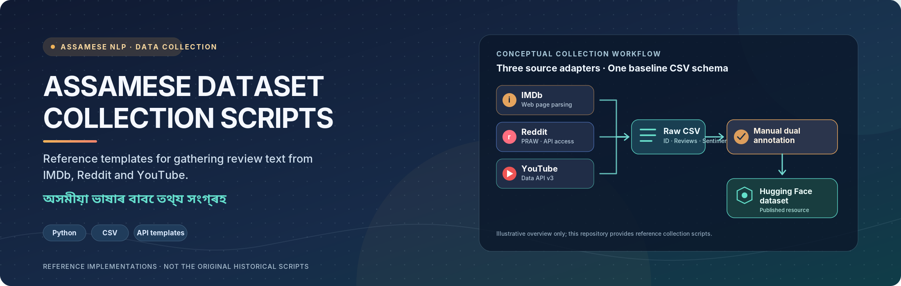

<p align="center">
  
</p>

# Assamese Dataset Collection Scripts

Reference implementations for the data collection methodology used to build the [Assamese Movie Reviews Sentiment Dataset](https://huggingface.co/datasets/AvinabhDutta-Dev/assamese-movie-reviews-sentiment) — an original, dual-annotated dataset of Assamese-language movie and drama reviews.

> **Note:** These are reference/template implementations demonstrating the collection approach across the three source platforms (IMDb, Reddit, YouTube). They are not the exact original scripts used, which were not preserved from the original collection process — adapt movie/video IDs, subreddits, and queries to your own targets.

<p align="center">
  <a href="https://huggingface.co/datasets/AvinabhDutta-Dev/assamese-movie-reviews-sentiment">
    
  </a>
  <a href="https://github.com/AvinabhDutta-Dev/assamese-sentiment-analysis">
    
  </a>
</p>

## Sources Covered

| Script | Platform | Auth Required |
|---|---|---|
| `imdb_scraper.py` | IMDb (English reviews) | No |
| `reddit_scraper.py` | Reddit r/assam (Romanized Assamese) | Yes — Reddit API |
| `youtube_scraper.py` | YouTube comments (mixed script/English) | Yes — YouTube Data API |

## Installation

Install the required packages before running any script:

```bash
pip install requests bs4 praw python-dotenv google-api-python-client
```

| Package | Used for |
|---|---|
| `requests` | HTTP requests in the IMDb reference scraper |
| `beautifulsoup4` | HTML parsing in the IMDb reference scraper |
|  `praw` | Reddit API access for the Reddit reference scraper |
| `python-dotenv` | Loading API credentials from the local `.env` file |
|  `google-api-python-client` | YouTube Data API v3 access |

Or simply install everything at once via the included requirements file:
```bash
pip install -r requirements.txt
```

See [SETUP.md](SETUP.md) for full step-by-step configuration instructions, including API credential setup.

## Output Format

All scripts output CSVs matching the dataset's baseline schema:

| Column | Description |
|---|---|
| `ID` | Sequential numeric identifier |
| `Reviews` | Raw scraped text |
| `Sentiment` | Left blank — populated later via manual dual-annotation |

A sample output (`sample_output/sample_scraped_reviews.csv`) is included to demonstrate the expected format without needing to run the scrapers yourself.

## Related

- 📊 [Dataset on Hugging Face](https://huggingface.co/datasets/AvinabhDutta-Dev/assamese-movie-reviews-sentiment)
- 🤖 [Models trained on this dataset](https://github.com/AvinabhDutta-Dev/assamese-sentiment-analysis)
- 📄 [Preprint](https://www.researchgate.net/publication/401660577_Sentiment_Analysis_of_Assamese_Reviews_using_Transfer_Learning_Models)
